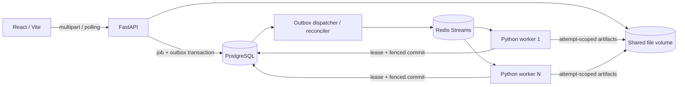

# QueueFlow

장애 복구와 데이터 일관성을 검증하는 비동기 CSV 처리 플랫폼. HTTP 요청은 파일과 작업을 영속 등록하고, 별도 Python 워커가 검증·정제·오류 보고서를 생성합니다. PostgreSQL이 최종 상태와 결과 참조의 기준이며 Redis Streams는 **at-least-once 전달**을 담당합니다.

**현재 상태:** 초기 main 커밋의 GitHub CI에서 PostgreSQL/Redis service를 사용한 pytest, 프론트엔드, Compose config가 성공했습니다. 후속 작업으로 초대 계정 로그인·사용자별 접근 제어와 운영 자원 한도를 추가하고 Docker Desktop을 D드라이브에 설치했습니다. Windows 재부팅이 필요해 새 버전의 홈 PC 컨테이너 복구·자원 실측은 아직 남았습니다. 최신 상태는 [배포 조건 점검](docs/TESTING.md), 인증 설계는 [초대 계정 문서](docs/AUTHENTICATION.md)를 보세요. 초기 [구현 보고서](docs/ARCHITECTURE.md)와 [검증 기록](docs/TESTING.md)은 해당 시점의 기록입니다.

## 구현 범위

- UTF-8/BOM CSV 업로드, 20 MiB·100,000행 제한, 실제 수신 바이트와 셀/행 크기 검사
- 필수 컬럼/값, 공백 제거, 정수·실수·ISO 날짜·기본 이메일 형식, 중복 검사와 제거
- `cleaned.csv`, `errors.csv`, `summary.json`; 기본 수식 셀 escape와 변경 수 공개
- 작업 목록/검색/필터/상세, 실행 시도·이벤트, 결과 다운로드, 협력적 취소
- 사용자 범위와 멱등 키의 DB 고유 제약, 동일 키의 다른 입력/규칙은 409
- 같은 트랜잭션의 작업/Outbox 생성, dispatcher의 `FOR UPDATE SKIP LOCKED`
- DB lease·독립 heartbeat·증가하는 fencing token, 지수 백오프, 최대 3회, Dead Letter
- `XREADGROUP`, `XAUTOCLAIM`, 영속 결과/재시도 확정 이후 `XACK`
- Redis 전달 유실 시 PostgreSQL의 QUEUED 작업 재발행, 만료 RUNNING 복구
- 로컬 drain/resume·보존기간 정리, 실제 관측 기반 운영 화면, CI 및 재현 스크립트
- 관리자 CLI로 생성하는 초대 계정, opaque/HttpOnly/Secure 세션, CSRF, 사용자별 작업·파일·멱등 키 분리

현재 범위는 CSV와 독립 작업 간 병렬 처리, 초대 계정 데모입니다. 단일 CSV 내부 분할 병렬화, YOLO/영상/AI, 공개 회원가입은 구현하지 않았습니다. 공개 모드의 실제 HTTPS 브라우저 로그인 검증과 운영 서버 적용은 아직 남았습니다.

## 구성



Python 3.13, FastAPI, Pydantic, SQLAlchemy 2, Alembic, psycopg, PostgreSQL 17, Redis 7.4, React 19, TypeScript, Vite, Tailwind 4, React Router, TanStack Query를 사용합니다. 실제 설치한 Python 전이 의존성은 [requirements-lock.txt](requirements-lock.txt), 프론트엔드는 [package-lock.json](frontend/package-lock.json)으로 고정했습니다. Docker 이미지의 minor 태그는 digest 고정이 아니며 Linux 이미지 실행 호환성은 미검증입니다.

## Windows PowerShell 실행

Docker Desktop의 Linux 엔진과 Compose v2, Node.js 24, Python 3.13이 필요합니다. 기존 서비스와 포트를 먼저 확인하세요. API는 기본 `127.0.0.1:8100`, 프론트엔드는 `5173`을 사용합니다. PostgreSQL과 Redis 포트는 호스트에 공개하지 않습니다.

```powershell
Set-Location <workspace-root>\queueflow
Copy-Item .env.example .env
docker compose config
docker compose up -d --build --scale worker=3
docker compose ps

Set-Location frontend
Copy-Item .env.example .env
npm ci
npm run lint
npm run build
npm run dev
```

프론트엔드: `http://localhost:5173`, API 문서: `http://localhost:8100/docs`.
선택적으로 `docker compose --profile ui up -d --build`로 정적 프론트엔드도 실행할 수 있습니다. 이 경우 Vite와 동시에 5173 포트를 사용하지 마세요.

일반 Python 개발/테스트 환경:

```powershell
python -m venv .venv
.\.venv\Scripts\Activate.ps1
python -m pip install -r requirements-dev.txt
python -m pytest -v
python -m ruff check backend worker shared scripts tests
```

이 작업 PC의 embedded Python을 위한 실행기는 `scripts/dev.py`입니다. `.deps`만 경로에 추가하므로 기존 포트폴리오 패키지를 바꾸지 않습니다.

```powershell
..\.tools\python\python.exe scripts/dev.py pytest -q
```

이 PC에서 Node가 PATH에 없으면 프론트엔드 명령 전에 현재 PowerShell 세션에만 추가합니다.

```powershell
$env:Path = '<workspace-root>\.tools\node;' + $env:Path
```

실제 PostgreSQL/Redis를 로컬 프로세스로 실행할 경우 `DATABASE_URL`, `REDIS_URL`, `STORAGE_ROOT`를 설정하고 `alembic -c backend/alembic.ini upgrade head`, `uvicorn backend.app.main:app --host 127.0.0.1 --port 8100`, `python -m worker.dispatcher`, `python -m worker.main`을 별도 터미널에서 실행합니다. 앱 시작 시 스키마를 생성하거나 삭제하지 않습니다.

## API 예시

Windows에서는 PowerShell 별칭 대신 `curl.exe`를 사용합니다.

```powershell
python -m scripts.generate_test_csv --rows 1000 --output output/sample.csv
curl.exe -i -X POST http://localhost:8100/api/v1/jobs -H "Idempotency-Key: sample-001" -F "file=@output/sample.csv"
curl.exe http://localhost:8100/api/v1/jobs
curl.exe http://localhost:8100/api/v1/jobs/JOB_ID
curl.exe -OJ http://localhost:8100/api/v1/jobs/JOB_ID/artifacts/cleaned
```

처리 규칙은 multipart `options`의 JSON 문자열로 보냅니다. 상세 계약은 [API 문서](docs/API.md)를 참고하세요. HTTP 202는 **등록 완료**이며 CSV 데이터 처리 성공을 뜻하지 않습니다.

## 검증과 장애 재현

```powershell
# 기존 운영 스택과 분리된 PostgreSQL/Redis 컨테이너에서 전체 테스트
docker compose -f docker-compose.test.yml up --build --abort-on-container-exit --exit-code-from tests
docker compose -f docker-compose.test.yml down

# 새 이름의 격리된 전체 스택에서 강제 종료·재시작 검증
python -m scripts.compose_recovery
```

통합 테스트는 매번 고유 PostgreSQL 스키마와 Redis 키를 만듭니다. 전체 스택 스크립트는 `queueflow-recovery-*` 프로젝트만 제어하고, 종료 후 볼륨은 보존합니다. 기존 서비스 또는 운영 볼륨을 초기화하지 않습니다. `down -v`, `FLUSHDB`는 정상 실행 절차에 없습니다.

직접 준비한 테스트 서비스에는 `TEST_DATABASE_URL=postgresql+psycopg://...`, `TEST_REDIS_URL=redis://...`를 설정하고 `pytest tests/integration -v`를 실행합니다. 이 환경변수가 없으면 실제 연동 테스트는 명시적으로 SKIP됩니다. [복구 시나리오와 ACK 규칙](docs/FAILURE_RECOVERY.md)에 9개 요구 시나리오를 매핑했습니다.

## 성능 측정

```powershell
# CSV 처리기만 측정: API/DB/Redis 처리량으로 해석하지 않음
python -m scripts.run_benchmark --mode processor --repeats 3

# 실제 스택에서 독립 작업 병렬 처리 비교. 각 실행 사이 온라인 워커 수 확인
docker compose up -d --scale worker=1
python -m scripts.run_benchmark --mode api --workers 1 --rows 100000 --jobs 4 --output output/workers-1.json
docker compose up -d --scale worker=2
python -m scripts.run_benchmark --mode api --workers 2 --rows 100000 --jobs 4 --output output/workers-2.json
docker compose up -d --scale worker=4
python -m scripts.run_benchmark --mode api --workers 4 --rows 100000 --jobs 4 --output output/workers-4.json
docker stats --no-stream
```

워커 축소 직후에는 제거된 워커의 heartbeat가 lease 시간 동안 남습니다. 스크립트는 **관측한 온라인 워커 수가 요청한 수와 같을 때만** 측정합니다. DB 부하 표본이 필요하면 측정 프로세스에서 접근할 수 있는 `BENCHMARK_DATABASE_URL`을 별도로 설정합니다. [실측 결과와 한계](docs/PERFORMANCE_TESTING.md)에 처리기 단독 결과를 기록했습니다. 분산 워커 1/2/4 비교와 복구 시간은 아직 미측정입니다.

## 운영 및 제한

```powershell
docker compose exec api python -m scripts.maintenance drain
# 현재 RUNNING 작업 종료 확인 후 QueueFlow만 정지
docker compose stop
docker compose up -d
docker compose exec api python -m scripts.maintenance resume
docker compose exec api python -m scripts.maintenance cleanup
```

drain 플래그는 파일 볼륨에 남으므로 재시작 후 명시적으로 resume해야 합니다. 23:57 drain, 00:00 정지, 07:00 기동 정책의 연결 지점만 제공하며 Windows 작업 스케줄러/BIOS/기존 서버 설정은 변경하지 않습니다. 보존기간 정리는 명시적인 관리 명령이며 자동 스케줄은 설치하지 않았습니다.

기본 실행은 고정된 `local` 사용자와 localhost 바인딩입니다. 초대 계정 로컬 검증은 `AUTH_MODE=session`, `COOKIE_SECURE=false`로 설정하고 관리자 CLI로 계정을 만듭니다. 공개 모드는 [인증 문서](docs/AUTHENTICATION.md)의 HTTPS·Secure cookie·origin 조건을 충족해야 합니다. 인증 기능이 추가됐다는 사실만으로 운영 검증이 끝난 것은 아닙니다. [배포 조건](docs/TESTING.md), [보안](docs/SECURITY.md), [Cloudflare 배포 준비](docs/DEPLOYMENT.md)를 확인하세요. 초기 main push와 Pages 등록은 사용자 승인으로 진행했으며 기존 포트폴리오·DNS·Tunnel·운영 서버 변경은 수행하지 않았습니다.
