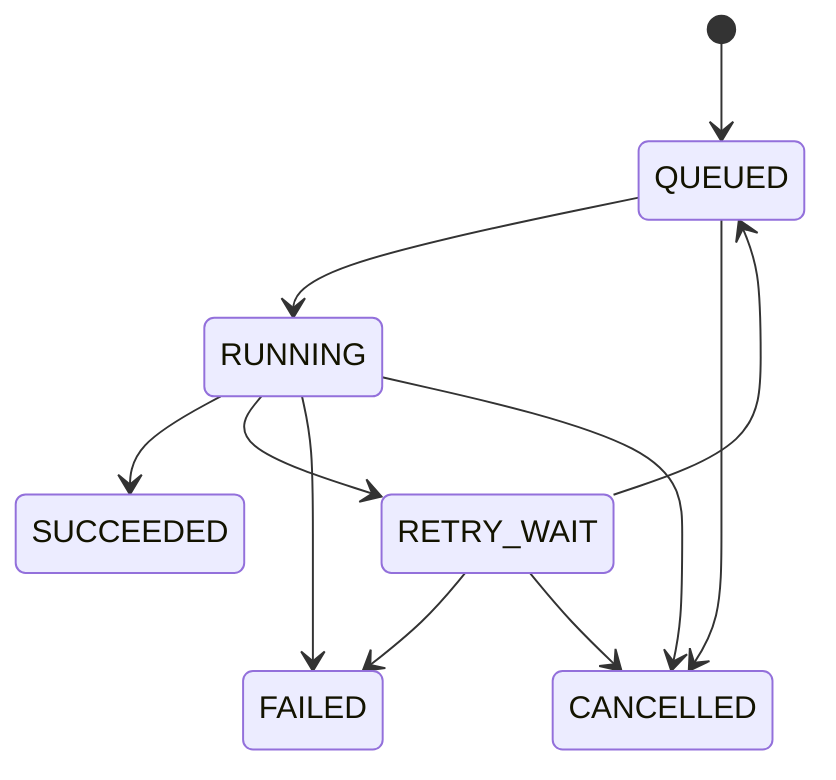

# 아키텍처와 작업 상태

## 책임과 경계

FastAPI는 요청 바이트 제한, multipart 수신, 안전한 입력 파일 저장, 헤더/규칙 기본 검증, DB 작업 등록을 담당합니다. 전체 행 검증과 정제는 수행하지 않습니다. Outbox dispatcher는 미발행 이벤트를 Redis로 보내고 DB 상태를 주기적으로 재조정합니다. 워커는 메시지를 실행 권한으로 취급하지 않으며 PostgreSQL에서 권한을 얻은 뒤 처리합니다.

`shared/contracts.py`는 상태·처리 옵션 계약, `worker/processors/csv_processor.py`는 DB/Redis와 무관한 CSV 처리기, `worker/recovery/ownership.py`는 상태/소유권 트랜잭션입니다. 다른 파일 처리기를 추가할 때 작업·복구 코드를 재사용할 수 있지만 현재 별도 registry나 빈 추상 클래스는 만들지 않았습니다. 파일 저장 어댑터는 `LocalStorage`이며 S3 전환 시 업로드/다운로드 및 로컬 staging 수명 관리를 추가해야 합니다.

## 상태 전이



`transition()`이 허용 전이를 검사합니다. 현재 재시도 한도 소진은 RUNNING → FAILED로 확정하며 RETRY_WAIT → FAILED는 계약상 허용하되 별도 관리 API는 없습니다. 종결 상태는 다시 실행하지 않습니다. RUNNING 취소는 DB 플래그와 heartbeat/체크포인트를 사용하며, 완료 직전 트랜잭션에서도 다시 검사합니다. 진행률 대신 실제 처리 행 수를 보여주고 총 행 수는 성공 후 확정합니다.

## 정상 처리

```mermaid
sequenceDiagram
  participant U as Browser
  participant A as FastAPI
  participant F as File volume
  participant P as PostgreSQL
  participant D as Dispatcher
  participant R as Redis Streams
  participant W as Worker
  U->>A: CSV + options + Idempotency-Key
  A->>F: bounded copy + fsync
  A->>P: BEGIN: job + input artifact + event + outbox
  P-->>A: COMMIT
  A-->>U: 202 + job_id
  D->>P: lock unpublished outbox
  D->>R: XADD job_id + outbox_id
  D->>P: mark published + event; COMMIT
  W->>R: XREADGROUP
  W->>P: lock QUEUED; increment token + attempt; lease
  W->>F: stream input; write attempt-scoped files
  W->>P: independent heartbeat + lease renewal
  W->>P: verify unexpired token; artifacts + SUCCEEDED + attempt COMMIT
  W->>R: XACK
  U->>A: poll status / download
```

## 일관성의 의미

보장하려는 대상은 DB에 등록되는 **단일 논리 결과 참조**입니다. 처리 자체나 Redis 메시지 발행이 정확히 한 번이라는 뜻이 아닙니다. `jobs/{id}/attempts/{token}/` 경로는 이전 시도가 파일을 써도 새 시도의 파일을 덮어쓸 수 없게 합니다. artifact 고유 제약과 fencing 검사를 통과한 트랜잭션만 최종 파일을 연결합니다. 실패한 시도의 파일은 고아가 될 수 있으며 정리 명령이 제거합니다.

DB 커밋 응답 유실은 성공/실패를 단정할 수 없습니다. API는 이 경우 입력 파일을 보존합니다. 동일 멱등 키 재요청으로 작업 ID를 복구하며, DB에 없는 오래된 입력만 정리합니다. 파일시스템과 PostgreSQL 사이의 원자적 트랜잭션은 없고 파일 볼륨 손상/DB 백업 불일치까지 자동 해결하지 않습니다.

## MVP와 후속 범위

현재 구현: 여러 독립 CSV 작업의 병렬 워커 처리, 폴링 UI, 로컬 운영 도구, 초대 계정·사용자별 접근 제어. 초기 커밋의 PostgreSQL/Redis 테스트 CI 단계는 성공했습니다. 새 인증 migration과 실제 홈 PC 컨테이너·전체 재시작·HTTPS 브라우저 검증은 [배포 조건](TESTING.md)에 남아 있습니다. 후속: 객체 저장소, 디스크 기반 중복 키, stream/DB 이력 보존 정책, 지속적인 CPU·메모리 운영 telemetry, 자동 retention 스케줄링. 현재 수동 Docker 자원 수집 도구는 제공하지만 실측은 재부팅 후 진행해야 합니다.

공식 참고: [SQLAlchemy transaction/session](https://docs.sqlalchemy.org/en/20/orm/session_basics.html), [Redis XAUTOCLAIM](https://redis.io/docs/latest/commands/xautoclaim/), [FastAPI file uploads](https://fastapi.tiangolo.com/tutorial/request-files/).
