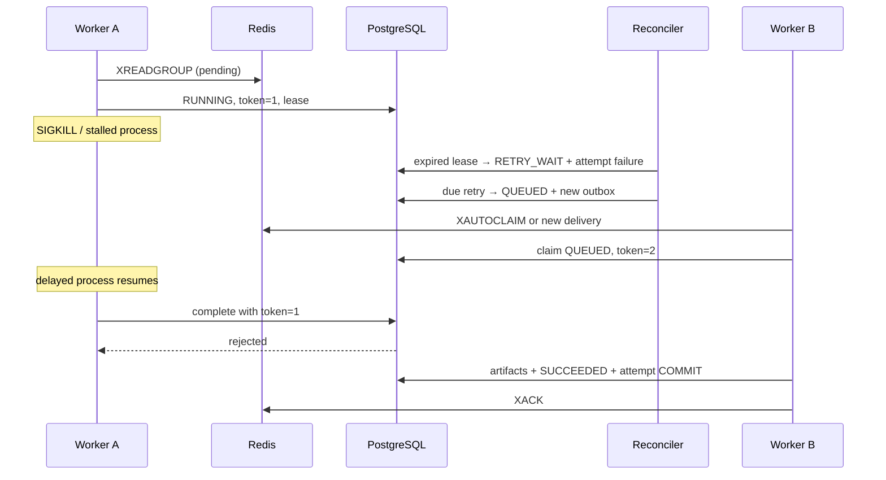

# 장애 복구와 ACK

## 실행 권한과 ACK 순서

Redis `queueflow:jobs`, Consumer Group `queueflow-workers`, 프로세스마다 hostname/PID/random consumer 이름을 사용합니다. 메시지는 job_id/outbox_id만 담습니다. `XAUTOCLAIM`은 pending 메시지의 전달 소유자만 바꾸며 DB의 실행 소유권을 주지 않습니다. 정상 heartbeat가 lease를 유지하면 다른 consumer는 RUNNING 작업을 재실행하거나 ACK하지 않습니다.

ACK 가능한 경우는 (1) SUCCEEDED/FAILED/CANCELLED 확정, (2) RETRY_WAIT와 next_retry_at 확정, (3) 이미 종결되었거나 재시도 예약이 있는 재전달 메시지입니다. 현재 실행자가 살아 있는 busy 전달이나 DB 상태를 확정할 수 없는 실패는 ACK하지 않습니다. DB에 없는 job_id는 처리할 작업이 없는 stale 메시지로 ACK합니다. 재시도 메시지는 새 Outbox로 발행하므로 기존 메시지를 예약 후 ACK해도 일정이 유실되지 않습니다.



기본 lease는 30초, heartbeat는 5초, pending 회수 idle은 30초입니다. 최초 포함 최대 3회이며 재시도 대기는 5초·10초 지수 백오프입니다. 재조정은 dispatcher가 매초 실행하고 QUEUED 재발행 최소 간격은 60초입니다. heartbeat의 DB 연결을 잃은 워커는 결과를 확정하지 않습니다. 복구 시간에는 lease·백오프·회수 대기·재처리 시간이 포함됩니다.

## 재현 매핑과 검증 상태

| 요구 시나리오 | 재현 코드 | 현재 실제 실행 |
|---|---|---|
| 1 정상 업로드→다운로드 | unit/test_api_pipeline, integration/test_actual_stream_pipeline | 단위 PASS / 실제 연동 NOT RUN |
| 2 동시 멱등 요청/409 | unit/test_concurrent_idempotency, integration/test_postgres_concurrent | SQLite PASS / PostgreSQL NOT RUN |
| 3 여러 독립 작업·워커 수 비교 | run_benchmark --mode api --workers 1/2/4 | NOT RUN |
| 4 Worker 강제 종료 | integration/test_sigkill_mid_processing_recovers, compose_recovery | NOT RUN |
| 5 파일 저장 후 DB 완료 전 종료 | integration/test_real_process_exit_in_commit_windows[after_files] | NOT RUN |
| 6 DB 완료 후 ACK 전 종료 | 같은 테스트 [after_commit], duplicate_delivery | NOT RUN |
| 7 Redis 중단/복구 | integration/test_redis_unavailable, compose_recovery Redis-stop | NOT RUN |
| 8 전체 서버 재시작 | compose_recovery full-stack-restart-volume-retention | NOT RUN |
| 9 오래된 워커 token 거부 | unit/test_stale_worker, integration/test_stale_token | SQLite PASS / PostgreSQL NOT RUN |

추가: Outbox XADD 이후 DB rollback 중복 발행, Redis 키 전체 소실 후 DB 재발행, pending idle보다 긴 정상 DB lease, malformed CSV의 비재시도 실패, API COMMIT 응답 유실을 검증하는 코드가 있습니다. 실제 Redis의 데이터 손실 테스트는 **fixture가 생성한 고유 stream 키만** 삭제합니다.

## 실행

```powershell
docker compose -f docker-compose.test.yml up --build --abort-on-container-exit --exit-code-from tests
docker compose -f docker-compose.test.yml down
python -m scripts.compose_recovery
```

첫 명령은 실제 PostgreSQL/Redis와 실제 subprocess 종료를 사용합니다. 마지막 스크립트는 새 `queueflow-recovery-*` Compose 프로젝트만 만들고 제어하며, Docker가 없으면 NOT RUN으로 종료합니다. 강제 종료와 SIGTERM graceful stop을 따로 검사합니다. 새 테스트 프로젝트의 볼륨도 자동 삭제하지 않습니다. 로그와 결과는 출력 JSON의 프로젝트 이름과 연결해 보관하세요.

장애 주입은 `QUEUEFLOW_TEST_MODE=1`과 환경변수 failpoint가 모두 있는 테스트 프로세스에만 존재합니다. HTTP 장애 주입 API는 없습니다. 이 설정은 production Compose에 포함되지 않으며 테스트 재현용 override에만 넣습니다. 실제 컨테이너 재현과 Python 함수 단위 검증을 같은 결과로 보고하지 않습니다.

## 종료·복구·파일 정리

SIGTERM은 새로운 수신을 멈추고 진행 중 작업을 끝내려 합니다. Compose stop_grace_period 180초를 넘으면 강제 종료될 수 있고 그 경우 lease 복구 대상입니다. `maintenance drain`은 API 등록과 새 worker 수신을 막는 공유 플래그이며 이미 진행한 등록/수신과의 짧은 경쟁 구간은 존재합니다. DB와 입력은 영속적이므로 해당 작업은 복구할 수 있습니다.

로컬 기본 168시간, 공개 데모 후보 24시간 보존입니다. `maintenance cleanup`은 종결 작업에만 만료를 적용하고 RUNNING/RETRY_WAIT/QUEUED 입력을 삭제하지 않습니다. 작업 디렉터리마다 시도별 파일을 분리하고 종결 작업에서 DB에 참조되지 않은 시도만 제거합니다. 24시간이 지난 미등록 업로드도 DB 부재를 확인한 뒤 정리합니다. 만료 파일 삭제는 파일시스템/DB의 한 트랜잭션이 아니므로 중간 장애 시 재실행으로 정리하며, 빠진 파일을 성공 결과로 만들어 제공하지 않습니다.

현재 stream 자동 trim과 DB 이력 retention은 미구현입니다. 무분별한 MAXLEN trim은 pending payload를 없앨 수 있으므로 적용하지 않았습니다. 파일 볼륨 자체 유실, DB와 파일의 불일치 백업, 멀티 호스트 시계/스토리지 내구성, 장기 GC 확장성은 후속 운영 과제입니다.
